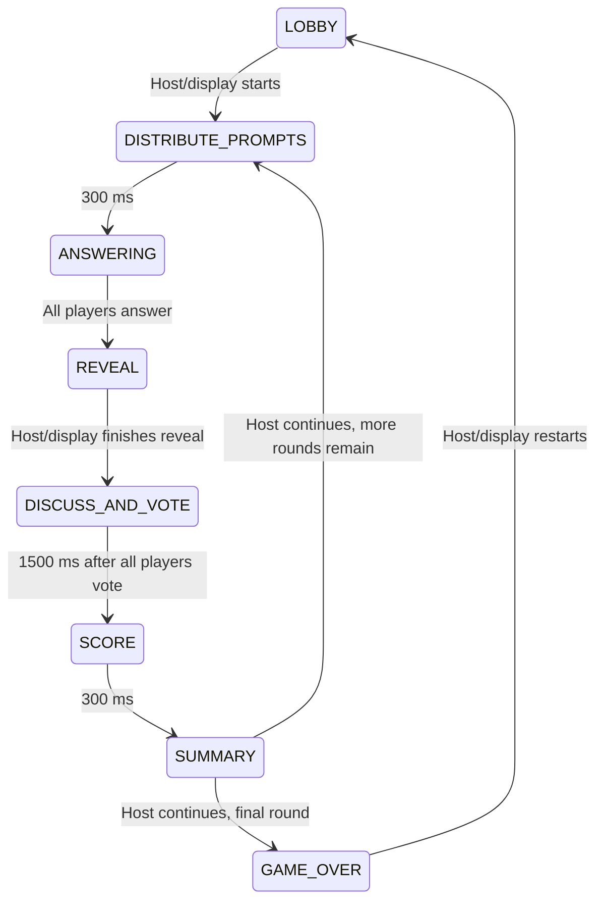

# Code structure and behavior

The browser renders the host/display and player views. The server owns rooms, prompt selection, answer/vote readiness, phases, and scores. Answering and voting have no deadlines. Socket.IO carries snapshots and player actions, including the host's `round:continue` action.

```text
src/
  main.tsx                  Browser entry point and styles
  App.tsx                   View selection and game context wiring
  game/
    GameContext.ts          State and actions used by components
    useGameSocket.ts        Incoming events, identity, and URL view selection
  lib/socket.ts             Typed Socket.IO connection to the page's origin
  components/
    display/                Shared-screen presentation and host setup
      DisplayRound.tsx      Table, reveal, voting, verdict, and score orchestration
      TableLayout.tsx       Perimeter seating and visible answer readiness
      AnswerCard.tsx        Central reading card and animated collection into the spread
      OriginalQuestion.tsx  Central question reveal and move into the heading
      DisplayFit.tsx        Fit shared-screen rounds into the available height
      useAnswerReveal.ts    Answer reading time, pause, and manual advance
      DesignPreview.tsx     Local sample round without sockets or real players
      DisplayFrame.tsx      Shared-screen brand, round information, and footer
    player/                 Phone join, answer, vote, and results views
    ui/                     Buttons, cards, avatars, spinners, transitions
  styles/main.css           Locally compiled Tailwind CSS
  styles/round.css          Table, card scene, responsive layouts, and motion
server/
  index.cjs                 Process startup, logging, and shutdown
  config.cjs                Local address, port, public domain, build path
  app.cjs                   HTTP and Socket.IO server assembly
  http/staticFiles.cjs      Built frontend, browser routes, health endpoint
  transport/socketHandlers.cjs  Socket events and host assignment
  game/
    rooms.cjs               In-memory rooms and player/socket lookup maps
    prompts.cjs             Random prompt pairs and per-room used-pair tracking
    engine.cjs              Phase changes, submissions, host advance, restart
    scoring.cjs             Existing citizen/impostor scoring calculation
shared/
  types.ts                  Game state, players, answers, votes, phases
  protocol.ts               Typed client/server event payloads
  presentation.json         Shared verdict, voter, and score presentation offsets
  prompts.json              Original 285 prompt pairs
scripts/
  dev.mjs                   Starts and stops local frontend/server together
  host.mjs                  Starts the built game and existing Cloudflare tunnel
  check-public.mjs          Tests a multiplayer round through the actual public domain
  cloudflared.mjs           Connector lookup, private token environment, forwarding rule
  test-public.mjs           Runs browser tests against simpleapp.qzz.io
  install-cloudflared.mjs   Official Windows connector download and checksum check
  configure-tunnel.ps1      Hidden input for saving the existing tunnel token
  start-game.cmd            Windows launcher for hosting
  tunnel.mjs                Runs the existing Cloudflare tunnel using its token
tests/
  game.test.cjs             Game regression checks with a controlled clock
  server.test.cjs           HTTP and real Socket.IO connection checks
  e2e/game.spec.ts          Real browser multiplayer gameplay
```

## Round flow



## Preserved rules

- The first non-display player joining a room is its host. Hosts and displays can start/restart games; displays do not receive prompts or count toward the player minimum.
- Defaults: 4 players and 6 rounds. Server bounds are 3–10 for the minimum and 2–10 rounds. Legacy answer/vote duration options are ignored.
- Each round chooses one random impostor and one unused prompt pair. Citizens receive the main prompt; the impostor receives its paired prompt. Used pairs reset when exhausted or when the game restarts.
- A player submits one nonblank answer per round, trimmed to 80 characters. The limit is shared by the phone, server, and preview through `presentation.json`. The game waits for everyone. The display presents cards in submission order, with 6.5–7.9 seconds of central reading time before collecting each into the spread. The original question gets its own central reading and collection beats. Pause and manual collection remain available. No reveal fallback can interrupt a pause. See [the design notes](design.md) for presentation timing.
- Results use `verdictRevealsAt` to synchronize the display and phones. The impostor appears after three seconds, voter names 2.5 seconds later, and scores 6.5 seconds after the impostor. Shared offsets are in `presentation.json`. Only a host or display can continue, after scores appear. Results never expire.
- Votes can be changed. A citizen earns one point for voting for the impostor. The impostor earns one point when fewer than `floor(playerCount / 2) + 1` votes target them. A tie therefore lets the impostor score.
- Scores accumulate across rounds. Restart keeps the room, players, and settings and clears scores/progress using the existing reset fields.

## Hosting and maintenance

Production has one server on `127.0.0.1:8080`, serving `dist/` and `/socket.io/`. Cloudflare forwards `simpleapp.qzz.io` to that address. Local development uses Vite on `127.0.0.1:5173`, proxying Socket.IO to the same backend. The browser always connects to its own origin; there is no separate server URL to configure in frontend code.

The server stays in CommonJS JavaScript so it runs directly under Node. The frontend and shared contracts use strict TypeScript. Formatting is managed by Prettier. React, icons, QR code generation, and Tailwind CSS are bundled locally; the game has no runtime CDN requirement.

The old mock backend, separate reverse proxy, LAN startup script, LocalXpose commands, generated metadata, and unused API-key injection have been removed. Connection effects own Socket.IO connect/disconnect cleanup, including React development Strict Mode. Errors thrown by game actions are reported to the requesting socket instead of crashing the server. Scoring calculations remain preserved. The display keeps one `DisplayRound` mounted across the round's phases. It transitions from the table to an answer spread, retaining those answer cards through voting and results. `AnswerCard` measures its reading and destination rectangles and uses the Web Animations API for collection; reduced-motion preferences skip decorative movement. Repeated reveal completion or vote changes during the lock period do not create extra phase or scoring timers. Restart cancels outstanding deal, vote-lock, and scoring callbacks.

Player identity is independent of the transport connection. The server issues a secret session token, stored in the browser's `sessionStorage` for the current tab. Player and display tokens use separate keys, with display tokens scoped to their room. A reconnect or refresh restores the same seat, host/display permissions, current snapshot, and private prompt; duplicate joins preserve existing scores and membership. The server stores private prompts separately from room snapshots, including prompts dealt while a player is offline. A replacement connection takes ownership before closing its predecessor, so a delayed disconnect cannot detach the new socket. Phones retain their current screen and answer draft during an interruption, show a reconnecting notice, and disable answer/vote submission until connected. Display reveal progress pauses while disconnected and resumes afterward. Disconnect/resume logs include the room, phase, player ID, and transport reason without exposing session tokens or prompts.

Known prototype limitations remain: rooms and sessions have no persistence or expiry. A disconnected player's seat is reserved until the server stops; answering and voting still wait for every player, so someone who leaves permanently must return in the same tab. Closing the tab or clearing its storage loses its recovery token. Restarting the server clears all games and sessions. Host status is not reassigned when the host leaves. State snapshots include the impostor ID and main question as before; a technically inclined player can inspect them.

Compatible dependency updates removed the reported production dependency advisories. The Tailwind 3 build toolchain still has development-only advisories in its transitive glob/selector packages. Tailwind 3 is retained to preserve existing styling; migrating to Tailwind 4 needs separate visual verification. Run `npm audit` to see the current report.
