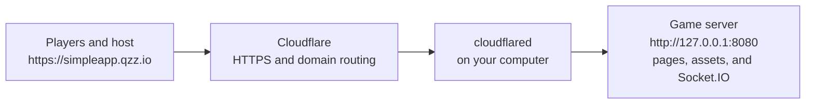

# Hosting at simpleapp.qzz.io

Your computer runs the game. Cloudflare provides the public HTTPS address and forwards traffic to it. A small program called `cloudflared` maintains that connection. The domain by itself does not start the game or keep your computer awake.



## Required route

The scripts create the required forwarding rule locally whenever you run `npm run host` or `npm run tunnel`. You do not need to find **Routes** or **Public Hostnames** in the dashboard. The existing DNS entry already connects `simpleapp.qzz.io` to your saved tunnel.

| Setting         | Value                           |
| --------------- | ------------------------------- |
| Public hostname | `simpleapp.qzz.io`              |
| Path            | Leave empty; forward every path |
| Service type    | HTTP                            |
| Service URL     | `127.0.0.1:8080`                |

The complete origin URL is `http://127.0.0.1:8080`. The connector must run on the same computer as the game. Changing `PORT` in `.env` updates the generated forwarding rule and the development proxy after a restart.

Use the existing tunnel and DNS entry for this domain. The generated rule sends every path for `simpleapp.qzz.io` to the game and returns 404 for other hostnames. Socket.IO uses WebSockets on the same hostname. Keep WebSockets enabled and avoid cache rules that cache `/socket.io/*` or `/health`.

The scripts generate `.tools/game-tunnel.yml` from the server settings and pass it to the existing named tunnel along with its token. It contains no credentials. HTTP/2 is used for the connector because QUIC registration timed out on this connection. Public pages still use HTTPS and the game still uses WebSockets.

## Start the game

After the one-time account setup below, start the game and its Cloudflare connector together:

```powershell
npm run host
```

This builds the frontend, starts the local server, waits for it to listen, and starts your existing Cloudflare tunnel. Leave this terminal running. **Ctrl+C** stops both. On Windows you can also double-click `scripts/start-game.cmd` in File Explorer.

For a fresh checkout, run `npm ci` and `npm run setup:tunnel` once first. The installer downloads Cloudflare's official Windows release into `.tools/cloudflared.exe` and verifies its SHA-256 digest. It does not need administrator access or change PATH.

Use `npm start` if you only want to run the local game without a connector. A separate, existing Windows connector service would need the same forwarding rule; this project's `npm run host` already starts the configured connector, so a service is not required.

For an already built copy, `npm run server` starts it without rebuilding.

## One-time Cloudflare account setup

The account owner needs to do these steps. The setup on this computer cannot sign in to your Cloudflare account or retrieve its private tunnel token automatically.

1. Open [the Cloudflare dashboard](https://dash.cloudflare.com) in your browser and sign in to the account that owns `simpleapp.qzz.io`.
2. Open **Networking → Tunnels** and select the existing game tunnel. In an older dashboard, open **Zero Trust → Networks → Connectors** instead. Reuse the tunnel that already has the `simpleapp.qzz.io` route.
3. Open its **Overview** tab, click **Add a replica**, and choose **Windows**. Copy the installation command. You will paste it into the helper below; do not run the copied command.
4. Open **PowerShell** on this computer (Start menu, type PowerShell, open Windows PowerShell). Run:

   ```powershell
   cd C:\Projects\Impostor-game
   npm.cmd run configure:tunnel
   ```

5. When it asks for the token or command, paste the command you copied and press **Enter**. Input is hidden. The helper extracts and validates the token, saves it in `.env`, and never executes the pasted command. It should print **Token saved privately in .env**. You do not need to share the token in chat.
6. You are done with the dashboard. The local scripts set up forwarding automatically. In PowerShell run:

   ```powershell
   npm.cmd run host
   ```

7. Leave that window open. Wait until `cloudflared` prints **Registered tunnel connection**, then check the public URLs below. The tunnel should also show **Healthy** in Cloudflare.

These token retrieval steps follow [Cloudflare's tunnel permissions guide](https://developers.cloudflare.com/cloudflare-one/networks/connectors/cloudflare-tunnel/configure-tunnels/remote-tunnel-permissions/). The scripts pass the token through Cloudflare's supported `TUNNEL_TOKEN` environment variable. See [the token parameter documentation](https://developers.cloudflare.com/cloudflare-one/networks/connectors/cloudflare-tunnel/configure-tunnels/run-parameters/#token). `.env` and downloaded binaries are ignored by Git.

If no tunnel exists in the account, stop at step 2 and check that you are signed into the right account. The current domain already points to a tunnel; replacing it requires updating its Cloudflare DNS association too.

To run just the connector alongside an already running game, use `npm run tunnel`. To reinstall/update the downloaded connector, stop hosting and run `npm run setup:tunnel`. For platforms other than Windows x64/x86, install `cloudflared` on PATH from [the official downloads](https://developers.cloudflare.com/cloudflare-one/networks/connectors/cloudflare-tunnel/downloads/).

A connector configured using an existing credentials file can continue using its existing `cloudflared` service or run command; `npm run tunnel` is the helper for a dashboard-managed connector token.

## Verify the public connection

With hosting running, open another PowerShell window in the repository and run `npm.cmd run check:public`. This checks the real public pages and assets, connects a display and three players through Cloudflare, plays an answering/voting/scoring cycle, and resets its test room. It reports success only after those checks pass.

For the full Chrome browser flow, run `npm.cmd run test:e2e:public` while hosting is running. It plays two rounds with a host and three phone-sized browsers through the public domain, then restarts the room.

Open these URLs after the local server and connector are running:

| URL                               | Expected result                                |
| --------------------------------- | ---------------------------------------------- |
| `https://simpleapp.qzz.io/health` | JSON with `ok: true` and `frontendReady: true` |
| `https://simpleapp.qzz.io/host`   | Game creation screen                           |
| `https://simpleapp.qzz.io`        | Player join screen                             |

Create a room from the public host URL, then join from a phone using mobile data. Starting a round and submitting an answer verifies the public WebSocket connection as well as the website. Open the host screen through the public domain so its QR code points players to that domain.

## Troubleshooting

| Symptom                                 | What to check                                                                                                                |
| --------------------------------------- | ---------------------------------------------------------------------------------------------------------------------------- |
| The local page will not open            | Keep `npm start` running and check its terminal for errors.                                                                  |
| Port 8080 is already in use             | Stop the previous game server, or change `PORT` in `.env` and restart hosting; its forwarding rule updates automatically.    |
| `Frontend build missing`                | Run `npm run build`, then start the server again.                                                                            |
| `cloudflared` is not found              | Run `npm run setup:tunnel` to install the project-local Windows connector.                                                   |
| HTTP 530 / error 1033                   | Cloudflare has no healthy connector for the tunnel; check its dashboard status, token, and running service.                  |
| HTTP 502 from Cloudflare                | The connector cannot reach the game; check the local page and the route's service port.                                      |
| Page loads but room creation/join hangs | Inspect the browser Network tab for `/socket.io/` WebSocket failures; check WebSockets, Access policies, and route coverage. |
| Phones cannot use the displayed link    | Open the host screen at `https://simpleapp.qzz.io/host`, then use its public QR code.                                        |

Your computer needs to stay on, connected to the internet, and awake while people play. Closing the game terminal, sleeping, or restarting the computer interrupts games. Rooms and scores live in memory, so a server restart clears them. Refreshing a player page currently creates a new connection rather than restoring that player; this is inherited prototype behavior.
